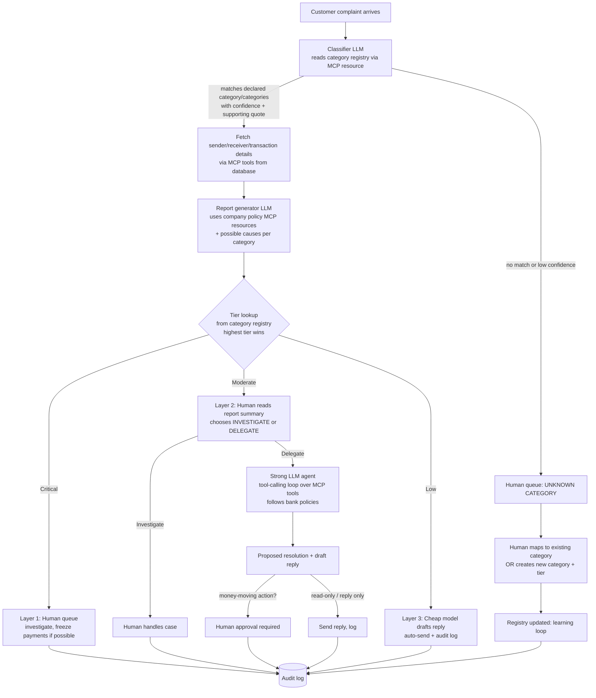

# Risk-Tiered Complaint Triage for a Fintech Bank — Architecture & Context

> Hackathon project. Theme: **"Human + AI: Better Together"**.
> This file is the shared context for everyone (and every coding agent) working on the project. Read it fully before writing code.

**Status tags used below**

- `[DECIDED]` — confirmed by the project owner. Do not change without asking.
- `[PROPOSED]` — recommended default. Use it unless told otherwise.
- `[OPEN]` — not decided yet. Ask the owner or pick the stated default and leave a `TODO(open)` comment.

---

## 1. One-paragraph summary `[DECIDED]`

A fintech bank receives customer complaints. Most are noise (frustration, app issues, simple questions), some need real investigation, and a few are serious (unauthorized transactions) and must be handled by a human. We build a **tree of agents arranged by risk**: every complaint is classified into one of a **fixed list of ~10 bank-defined categories**, each category has a **fixed risk tier** (Critical / Moderate / Low), and the tier decides how much intelligence and how much human involvement the complaint gets:

| Tier | Who handles it | Model cost |
|---|---|---|
| **Critical** | A human bank employee (AI only prepares the report) | Report generation only |
| **Moderate** | A human reads a summary and chooses: investigate personally **or** delegate to a stronger LLM agent | High-token, higher-intelligence model |
| **Low** | A cheap, fast model writes the reply | Low-token model (e.g. Gemma — verify availability) |

Any complaint that does not fit the declared categories goes to a human. Human decisions are logged and used to improve the system.

Real-world scope is "cover as many complaint types as possible". **Hackathon scope is deliberately small (10 categories) but must work precisely in the demo.**

---

## 2. Design principles `[DECIDED]` unless tagged

1. **Rules decide, AI proposes.** The risk tier comes from a lookup table (the category registry), never from the LLM's opinion.
2. **Unknown means human.** Anything outside the declared categories, or low-confidence, is forwarded to a human.
3. **Spend tokens where risk is.** Cheap model for low risk, strong model for moderate risk, humans for critical.
4. **Humans own money-moving actions.** `[PROPOSED]` No tool that moves money or freezes accounts runs without a recorded human approval, even in the "delegated to agent" path.
5. **Everything is logged.** Every classification, report, human decision, and tool call is stored with its evidence (audit log).
6. **Use existing SDKs and libraries.** Time is very short. Do not build custom frameworks or novel logic where a library exists.
7. **Synthetic data only.** No real customer data anywhere.

---

## 3. End-to-end flow



### Step-by-step

1. **Intake.** A complaint (free text, plus customer/account ID) enters the system.
2. **Classification.** An LLM reads the category registry (MCP resource) and returns one or more matching categories, each with a confidence and a short quote from the complaint justifying it, or `none`.
3. **Evidence fetch.** MCP tools pull sender, receiver, transaction, and history details from the database.
4. **Report generation.** An LLM writes a structured report: summary (at the top), category, likely causes, relevant policy references, evidence, recommended next step. It uses the generic company policy documents (MCP resources).
5. **Tier routing.** Tier is looked up from the registry. If several categories match, the **highest tier wins**.
6. **Layer handling** (section 4).
7. **Logging and learning** (sections 8 and 9).

---

## 4. Agentic layers by risk

### Layer 1 — Critical (human-led) `[DECIDED]`

- Examples: unauthorized transaction, suspected account takeover, lost/stolen device or card.
- The AI produces the full report and evidence pack; a **human bank employee investigates**.
- Human can freeze payments (if possible) through the `freeze_payment` tool — **tool executes only after the human clicks approve** `[PROPOSED]` (enforced in code, not by prompt).
- No LLM replies to the customer on its own.

### Layer 2 — Moderate (human chooses the path) `[DECIDED]`

- Examples: wrong-recipient transfer, failed-but-deducted payment, delayed transfer, duplicate charge/merchant dispute.
- The report has a **summary at the top**. The human reads **only the summary** and picks:
  - **Investigate myself** → moves to the human case view (same as Layer 1), or
  - **Delegate to agent** → a **higher-intelligence, higher-token model** investigates using MCP tools and bank policies.
- The human's choice, with category and details, is logged (used for the learning loop `[PROPOSED]`).
- Agent guardrails `[PROPOSED]`:
  - Read-only tools plus `draft_reply` are allowed freely.
  - Any money-moving tool call becomes a **proposal** that waits for human approval.
  - Hard step limit on the tool-calling loop (e.g. 8 steps) and a timeout.
  - Output is a proposed resolution + draft reply, shown to the human before anything irreversible.
  - `[OPEN]` Whether the human reviews every delegated resolution or only money-moving ones. Default: reply-only resolutions send automatically and are logged; money-moving ones need approval.

### Layer 3 — Low (cheap and fast) `[DECIDED]`

- Examples: app/login issues, fee questions, general frustration or feedback.
- A **low-token model** (e.g. Gemma; `[OPEN]` verify what the provider offers) generates a response. This is its only task.
- `[PROPOSED]` Safeguards:
  - If the reply-generation step detects hints of money loss or an unresolved serious issue, escalate one tier.
  - A random sample of auto-sent replies is shown in a human audit view.
  - Auto-sent replies are always logged.

---

## 5. Category registry `[DECIDED structure, PROPOSED contents]`

Fixed list, defined by the bank, exposed to the LLM as an **MCP resource**. 3 critical, 4 moderate, 3 low. Contents below are suggestions; edit freely.

| # | Category id | Tier |
|---|---|---|
| 1 | `unauthorized_transaction` | critical |
| 2 | `account_takeover` | critical |
| 3 | `lost_or_stolen_device` | critical |
| 4 | `wrong_recipient_transfer` | moderate |
| 5 | `failed_payment_money_deducted` | moderate |
| 6 | `delayed_or_pending_transfer` | moderate |
| 7 | `duplicate_charge_or_merchant_dispute` | moderate |
| 8 | `app_or_login_issue` | low |
| 9 | `fees_and_charges_question` | low |
| 10 | `general_frustration_or_feedback` | low |

Each registry entry:

```json
{
  "id": "unauthorized_transaction",
  "name": "Unauthorized transaction",
  "tier": "critical",
  "description": "Customer reports a transaction they did not make or authorize.",
  "example_complaints": ["I see a transfer I never made", "money left my account without my approval"],
  "possible_causes": ["credential theft", "SIM swap", "phishing", "family member use"],
  "policy_refs": ["policy_unauthorized_txn"],
  "source": "seed"
}
```

`source` is `seed` for the original 10, or `human_added` for categories created later in the learning loop.

### Routing rules `[DECIDED unless tagged]`

- **Tier is looked up from the registry. The LLM never chooses it.**
- **Unknown category** (LLM returns `none`) → human queue.
- **Multiple matches** (e.g. app crash + unauthorized transaction) → use the **highest tier**. `[PROPOSED]`
- **Low confidence or missing supporting quote** → human queue. `[PROPOSED]`
- **Danger-phrase floor** `[PROPOSED]`: a small keyword list ("didn't make this", "hacked", "stolen", "not me") forces tier to at least critical, regardless of the LLM. This catches the worst failure: a real fraud complaint answered by the cheap model.
- When unsure, go **up** a tier, never down.

---

## 6. MCP design

### Resources (read-only context) `[DECIDED]`

- `policies://...` — generic company policy documents (one short page per category: causes, checks, standard response). Label them "sample bank policy". Do **not** cite real regulation numbers unless verified.
- `categories://registry` — the category registry above.

### Tools (actions the agent can call) `[DECIDED]`

Functions the moderate-tier agent uses to investigate, plus actions for other layers. Suggested set `[PROPOSED]`:

| Tool | Type | Used by |
|---|---|---|
| `get_transaction(txn_id)` | read | classifier flow, Layer 2 agent |
| `get_sender(account_id)` | read | report generator, Layer 2 agent |
| `get_receiver(account_id)` | read | report generator, Layer 2 agent |
| `get_customer_history(customer_id, days)` | read | Layer 2 agent |
| `check_merchant(merchant_id)` | read | Layer 2 agent |
| `search_policy(query)` | read | Layer 2 agent |
| `draft_reply(case_id, text)` | write (safe) | Layer 2 and 3 |
| `send_reply(case_id)` | write | Layer 3 auto, Layer 2 after review |
| `freeze_payment(txn_id or account_id)` | **money-moving** | **only after human approval** |
| `issue_refund(txn_id, amount)` | **money-moving** | **only after human approval** |

### Using fastn `[DECIDED: use where applicable, do not force everywhere]`

- **fastn** (https://docs.fastn.ai/) is a hosted integration platform. Its **MCP gateway** exposes fastn connectors, actions, and workflows as tools to MCP clients at a hosted URL, authenticated by OAuth or an API key (`Authorization: Bearer fsk_live_...`), with scoping of which tools are reachable.
- Natural fits for fastn here: notifying the human officer (Slack/email), sending the customer reply, creating a ticket for critical cases, logging cases to a sheet. Possibly DB-backed lookups if its built-in Postgres is quick to use.
- fastn docs reviewed so far describe **tools only**. `[OPEN]` Whether fastn can serve MCP **resources**. Default: run our own small MCP server for the two resources (policies, category registry) and use fastn for the app-integration tools. Keep a local fallback implementation of every tool so a fastn outage cannot break the demo.
- **Warning:** fastn docs state test keys are not a sandbox; they hit the same live connections. Connect only throwaway accounts. `freeze_payment` and `issue_refund` act on **our synthetic database only**.
- `[OPEN]` fastn account/workspace: create it early; signup may include a validation step.

### fastn integration `[DECIDED]`

fastn handles three outbound workflows and nothing else. It holds no policy and makes no decisions;
FastAPI owns classification, routing, policies, the MCP server and approvals.

1. `notify_officer`: send a case summary to the assigned officer (email/Slack/webhook).
2. `create_ticket`: create an external ticket.
3. `send_approved_reply`: deliver a backend-authorized reply to the customer.

The backend calls them through `FastnGateway` (HTTP). If fastn is unavailable, errors, or reports
`success: false`, the call falls back to `LocalGateway` (logs only) and the fallback is recorded in the audit log.

```
FASTN_ENABLED=true
FASTN_GATEWAY_URL=https://api.fastn.ai/api/v1/workflows
FASTN_API_KEY=<secure_token>
FASTN_ENV=live                    # sent as x-fastn-env; test keys are NOT a sandbox
FASTN_AUTH_METHOD=bearer          # or api_key_header (sends X-API-Key)
FASTN_TIMEOUT_SECONDS=30
REPLY_AUTH_SECRET=<shared secret> # fastn uses it to validate authorization_token
OFFICER_EMAIL=                    # optional, passed to notify_officer
DASHBOARD_URL=                    # optional, ticket links to <url>/cases/<id>
```

Tool contract: `POST {FASTN_GATEWAY_URL}/<name>/execute` with body `{"input": {...}}`:

```
notify_officer       input { complaint_id, category, risk_tier, summary, required_action, officer_email? }
                     -> { success, sent_via, message_id, error }
create_ticket        input { complaint_id, category, summary, risk_tier, dashboard_url? }
                     -> { success, ticket_id, ticket_url, error }       (fastn deduplicates)
send_approved_reply  input { complaint_id, reply_text, authorization_token, recipient_email? }
                     -> { success, sent_at, error }
```

`authorization_token` = HMAC-SHA256 (key `REPLY_AUTH_SECRET`) of `"<complaint_id>:<sha256(reply_text)>"`.
Only backend code can produce it, and it is bound to the exact reply text.

Data flow: backend classifies and decides the tier, retrieves policies, generates the report, then calls
`notify_officer` (and `create_ticket` for critical cases); fastn delivers; the backend records the result
in the audit log. Money-moving actions are never exposed through fastn.

---

## 7. Tech stack `[PROPOSED]`

| Concern | Choice |
|---|---|
| Backend / API | Python, FastAPI |
| Storage | SQLite (cases, decisions, registry, synthetic data) |
| LLM access | The provider's official Python SDK (one OpenAI-compatible provider); model names in a config file so tiers can be swapped quickly |
| Structured output | Pydantic models; LLM must return JSON matching the schema |
| MCP server (our own) | Official MCP Python SDK / FastMCP for resources (and local tool fallbacks) |
| Tool integrations | fastn MCP gateway where applicable |
| Agent loop (Layer 2) | Plain tool-calling loop with a step limit. **No agent framework.** |
| Frontend | One FastAPI-served page, plain HTML + small JS (or HTMX). No build step. |
| Deployment | `[OPEN]` hackathon notes mention a specific cloud ("Alternate Clouds"). Confirm requirements. Default: single deployable app. |

Model configuration (`config.py` or `.env`):

```
CLASSIFIER_MODEL=...      # cheap/fast, structured output
REPORT_MODEL=...          # [OPEN] cheap or mid; default same as classifier
LOW_TIER_REPLY_MODEL=...  # cheap (e.g. Gemma if available)
AGENT_MODEL=...           # stronger, used only for delegated moderate cases
```

---

## 8. Data model `[PROPOSED]`

```
customers(id, name, phone, created_at)
accounts(id, customer_id, balance, status)            -- status: active|frozen
transactions(id, sender_account, receiver_account, amount, merchant_id, channel, device_id, created_at, status)
merchants(id, name, complaint_count)
complaints(id, customer_id, text, received_at, true_category, true_tier)   -- true_* only for synthetic test set
cases(id, complaint_id, categories_json, confidence_json, quotes_json,
      tier, status, report_json, assigned_layer, created_at)
decisions(id, case_id, actor, action, payload_json, evidence_json,
          model, created_at)                          -- the audit log
categories(id, name, tier, description, examples_json, causes_json, policy_refs_json, source)
learning_examples(id, complaint_text, human_category_id, created_at)
```

Case status values: `new`, `awaiting_human`, `delegated`, `agent_running`, `awaiting_approval`, `resolved`, `auto_replied`.

Audit log rule: **every** classification, report, tool call, human click, and auto-reply writes a `decisions` row with the evidence shown and the model name.

---

## 9. Human interface and learning loop

### Human dashboard `[DECIDED concept, PROPOSED details]`

- **Critical queue** (investigate, approve freeze).
- **Moderate queue**: shows only the summary; two buttons: **Investigate** / **Delegate to agent**.
- **Unknown-category queue**: human maps to an existing category or creates a new one.
- **Low-tier audit view**: sampled auto-sent replies.
- **Case detail**: report, evidence, tool-call trace (shows MCP usage), decision history.
- **Metrics panel**: see section 10.

### Learning loop `[PROPOSED]`

- When a human resolves an unknown-category complaint:
  - map to existing category → save as a `learning_example`, retrieved as few-shot examples in the classifier prompt;
  - create new category + tier → insert into `categories` (`source=human_added`); it is immediately available through the registry resource.
- Human tier corrections and Layer 2 investigate/delegate choices are stored and surfaced as examples.
- Demo moment: the same unseen complaint type is escalated the first time and handled automatically after a human teaches the system once.

---

## 10. Sealed test set and metrics `[PROPOSED]`

Create **60–100 synthetic complaints with known correct category and tier before writing logic**, so reported numbers are honest.

Include:

- clear examples of each of the 10 categories,
- a few multi-issue complaints (e.g. app issue + unauthorized transaction),
- 8–10 complaints that match **none** of the categories,
- a few vague or angry complaints that are ambiguous.

Metrics to report:

1. **Critical recall** — every critical complaint reached a human. Target **100%**. Headline number.
2. **Category accuracy** on in-list complaints.
3. **Unknown-routing rate** — out-of-list complaints sent to a human.
4. **Cost saving** — share handled by the cheap model and token cost vs sending everything to the strong model.
5. **Over-escalation rate** — low complaints pushed up unnecessarily (acceptable if somewhat high).
6. **Learning effect** — second run after human corrections has fewer misroutes / unknowns.

Add a script `eval/run_eval.py` that runs the whole set and prints these numbers.

---

## 11. Suggested repo layout `[PROPOSED]`

```
.
├── ARCHITECTURE.md
├── app/
│   ├── main.py              # FastAPI app, routes
│   ├── config.py            # model names, thresholds, keywords
│   ├── db.py                # SQLite setup
│   ├── schemas.py           # Pydantic models (classification, report, decisions)
│   ├── classify.py          # LLM category matching + confidence + quotes
│   ├── routing.py           # tier lookup, danger-phrase floor, highest-tier-wins
│   ├── report.py            # report generation
│   ├── agents/
│   │   ├── low_reply.py     # Layer 3 cheap reply
│   │   └── moderate_agent.py# Layer 2 tool-calling loop
│   ├── approvals.py         # gate for money-moving tools
│   └── audit.py             # decisions log writer
├── mcp_server/
│   ├── server.py            # resources: policies, category registry; local tool fallbacks
│   └── policies/*.md        # generic policy documents
├── seed/
│   ├── make_synthetic_data.py
│   └── complaints_labeled.json
├── eval/run_eval.py
└── web/                     # dashboard HTML/JS
```

---

## 12. Build order (8-hour window) `[PROPOSED]`

1. Synthetic database + labeled complaint set (before any logic).
2. Category registry + MCP resources (policies, categories).
3. Classifier + routing rules (tier lookup, danger-phrase floor); test against labels.
4. Evidence-fetch tools + report generator.
5. Human queues with audit log and approval gate (critical + moderate choice).
6. Layer 3 cheap reply; Layer 2 delegated agent.
7. Metrics panel and `run_eval.py`.
8. Unknown-category learning loop.
9. Demo script and rehearsal.

If time runs short, cut in this order: polish → Layer 2 delegated-agent depth → learning-loop sophistication (keep it simple: store corrections, show them as few-shot examples). **Never cut:** tier lookup rules, critical recall, approval gate, audit log.

---

## 13. Demo plan (about 6 minutes) `[PROPOSED]`

1. Submit a low complaint → cheap model replies; show audit entry.
2. Submit a moderate complaint → human reads the summary and delegates → agent uses MCP tools → proposed resolution.
3. Submit a critical complaint ("I didn't make this transfer") → human queue, approve freeze, audit log.
4. Submit an out-of-list complaint → goes to a human, who creates a new category.
5. Submit a similar complaint again → handled automatically.
6. Run the sealed test set and show the numbers (critical recall, cost saving, unknown routing).

Two-sentence pitch: *"Banks get thousands of complaints and most don't need an expert. We route each complaint to the right level of intelligence — cheap AI for simple replies, a stronger agent for moderate cases a human chooses to delegate, and humans for anything involving fraud or money — and every decision is logged and teaches the system."*

---

## 14. Constraints and rules

- **Synthetic data only.** No real customer or bank data.
- **No real-world money actions.** `freeze_payment` / `issue_refund` act only on the local synthetic DB.
- **Language:** keep the UI, data, pitch, Discord, and venue communication in **English**. The hackathon handbook reportedly has a rule against repeated Urdu use; verify the exact wording before showing any Roman Urdu on screen.
- **Credit third-party work.** The handbook requires crediting any copied public/third-party work.
- **Policy documents are generic samples.** Do not claim real regulatory compliance or quote real regulation unless verified.
- **Safety framing for judges:** the system recommends; humans approve anything irreversible; every decision is auditable.

### Scoring rubric weights (known so far)

Reliability 25, Usefulness 20, Creativity 15, Theme ("Human + AI: Better Together") 15, Automation depth (multiple tool calls in one workflow) 15, UX/demoability 10.

---

## 15. Open questions

| # | Question | Default if unanswered |
|---|---|---|
| 1 | Which LLM provider and models are available for each tier (is Gemma available)? Rate limits and credits? | One OpenAI-compatible provider; model names in config |
| 2 | Is deployment required (e.g. the "Alternate Clouds" mention), and any single-service/port limits? | Single deployable FastAPI app |
| 3 | Is MCP usage mandatory or a bonus? | Show a visible MCP tool-call trace in the case view |
| 4 | fastn: account/workspace created? Can it serve resources? Is it required/sponsored? | Own MCP server for resources; fastn for app-integration tools; local fallbacks |
| 5 | Team size and who owns backend vs frontend? | Simple HTML dashboard served by FastAPI |
| 6 | Deadline and demo format (live judge input vs scripted)? | Text box to submit complaints plus a "run test set" button |
| 7 | Which model generates the report: cheap or mid-tier? | Same as classifier model |
| 8 | Does the human review every delegated moderate resolution, or only money-moving ones? | Only money-moving ones; replies logged |

---

## 16. Instructions for coding agents working in this repo

1. Treat `[DECIDED]` items as requirements. Treat `[PROPOSED]` items as defaults. Ask before changing either.
2. **Never let the LLM set the tier.** Tier = registry lookup + deterministic floor rules.
3. **Never execute `freeze_payment` or `issue_refund` without a stored approval record** tied to a human `decisions` row. Enforce in code (`approvals.py`), not in prompts.
4. Every LLM call that feeds a decision must return **Pydantic-validated JSON**; reject and route to a human on parse failure.
5. Prefer official SDKs and existing libraries. Do not add agent frameworks or custom orchestration.
6. Write to the audit log (`decisions`) on every classification, report, tool call, and human action.
7. Keep model names, thresholds, and the danger-phrase list in config, not hard-coded.
8. All data is synthetic. Never add real PII or real credentials to the repo; keep API keys in `.env`.
9. If you must make an open-question decision, take the stated default and leave `TODO(open)` with the question number.
10. Keep UI text, comments, and docs in English.
