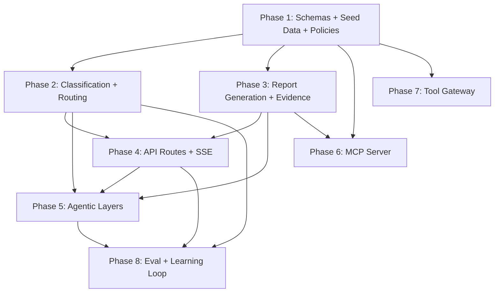

# Backend Implementation Plan — Ombot

> Derived from [ARCHITECTURE.md](file:///c:/Study/Coding/Projects/ombot/ARCHITECTURE.md) and [TECH_STACK.md](file:///c:/Study/Coding/Projects/ombot/TECH_STACK.md).
> **Scope:** Everything in `backend/` except fastn integration (another developer).
> **Excludes:** Frontend code, fastn gateway implementation.

---

## What Already Exists

| File | Status | Notes |
|---|---|---|
| [`pyproject.toml`](file:///c:/Study/Coding/Projects/ombot/backend/pyproject.toml) | ✅ Done | All deps declared (fastapi, sqlmodel, openai, mcp, sse-starlette, faker, httpx, pydantic-settings) |
| [`app/config.py`](file:///c:/Study/Coding/Projects/ombot/backend/app/config.py) | ✅ Done | Settings with LLM, fastn, DB, thresholds, danger phrases |
| [`app/db.py`](file:///c:/Study/Coding/Projects/ombot/backend/app/db.py) | ✅ Done | Engine, `init_db()`, `get_session()` |
| [`app/models.py`](file:///c:/Study/Coding/Projects/ombot/backend/app/models.py) | ✅ Done | All 8 tables: Customer, Account, Merchant, Transaction, Category, Complaint, Case, Decision, LearningExample |
| [`app/main.py`](file:///c:/Study/Coding/Projects/ombot/backend/app/main.py) | 🟡 Skeleton | Lifespan, `/api/health`, SPA mount. No API routes yet |
| `seed/` | ❌ Empty | |
| `eval/` | ❌ Empty | |
| `app/schemas.py` | ❌ Missing | |
| `app/classify.py` | ❌ Missing | |
| `app/routing.py` | ❌ Missing | |
| `app/report.py` | ❌ Missing | |
| `app/audit.py` | ❌ Missing | |
| `app/approvals.py` | ❌ Missing | |
| `app/agents/` | ❌ Missing | |
| `app/tools/` | ❌ Missing | |
| `app/mcp_server/` | ❌ Missing | |

---

## Phases

### Phase 1 — Schemas + Seed Data + Seeder Script
**Goal:** Contract-first. Define every Pydantic schema the API will use, create the synthetic data generator, and seed the DB so all later phases have data to work with.

**Files to create/modify:**

#### 1a. `app/schemas.py` — Pydantic request/response models
These are the **API contract** between backend and frontend.

```
# Classification (LLM output)
ClassificationResult:
    categories: list[CategoryMatch]     # each has category_id, confidence, supporting_quote
    raw_category: str | None            # "none" if no match

CategoryMatch:
    category_id: str
    confidence: float
    supporting_quote: str

# Report (LLM output)
ReportResult:
    summary: str
    category: str
    likely_causes: list[str]
    policy_references: list[str]
    evidence: dict                      # transaction/account details pulled
    recommended_next_step: str

# API schemas
ComplaintSubmit:                         # POST /api/complaints body
    text: str
    customer_id: str | None

CaseOut:                                # GET /api/cases, GET /api/cases/{id}
    id, complaint_id, complaint_text, categories, confidence, quotes,
    tier, status, report, assigned_layer, created_at

DecisionCreate:                         # POST /api/cases/{id}/decision
    action: Literal["approve", "reject", "investigate", "delegate", "map_category"]
    payload: dict = {}

CategoryCreate:                         # POST /api/categories
    id, name, tier, description, examples, causes, policy_refs

DecisionOut:                            # GET /api/audit
    id, case_id, actor, action, payload, evidence, model, created_at

MetricsOut:
    total_cases, by_tier, by_status, critical_recall,
    category_accuracy, cost_saving_pct, ...

EvalResultOut:
    metric_name, value, details
```

#### 1b. `seed/complaints_labeled.json` — Hand-written labeled complaint set
60–100 complaints with `true_category` and `true_tier`. Cover:
- 5–8 clear examples per category (10 categories × ~6 = 60)
- 5 multi-issue complaints (e.g., app crash + unauthorized transaction)
- 8–10 out-of-list complaints (should route to human/unknown)
- 5 vague/angry/ambiguous complaints

#### 1c. `seed/make_synthetic_data.py` — Synthetic data generator
Uses **Faker** to generate:
- ~50 customers with phone numbers
- ~100 accounts (1–3 per customer, balance, status)
- ~10 merchants with varying complaint counts
- ~300 transactions (various amounts, channels, devices, statuses)
- The 10 seed categories from ARCHITECTURE.md §5
- Complaints from `complaints_labeled.json` linked to random customers
- No decisions/cases yet — those are runtime artifacts

Script should be idempotent: drop and recreate tables, then seed.

#### 1d. Policy documents — `app/mcp_server/policies/*.md`
One short markdown file per category:
- `policy_unauthorized_txn.md`
- `policy_account_takeover.md`
- `policy_lost_stolen_device.md`
- `policy_wrong_recipient.md`
- `policy_failed_payment.md`
- `policy_delayed_transfer.md`
- `policy_duplicate_charge.md`
- `policy_app_login.md`
- `policy_fees_charges.md`
- `policy_general_feedback.md`

Each contains: common causes, standard checks, response template. Labeled as "sample bank policy."

> [!IMPORTANT]
> **Phase 1 is the foundation.** Nothing else works without schemas and data. The schemas also serve as the contract the frontend developer will code against.

---

### Phase 2 — Classification + Routing (Core Pipeline)
**Goal:** A complaint goes in, gets classified, gets a tier, and lands in the right queue.

**Files to create:**

#### 2a. `app/classify.py` — LLM-based classifier
- Takes complaint text + category registry (loaded from DB)
- Builds a prompt that includes all category descriptions and examples
- Includes few-shot `LearningExample` rows if any exist
- Calls the LLM (OpenAI SDK, `settings.classifier_model`) requesting structured JSON output matching `ClassificationResult`
- Validates with Pydantic; on parse failure, returns `none` (routes to human)
- Logs the classification as a `Decision` row (actor=`system`, action=`classify`)

#### 2b. `app/routing.py` — Deterministic tier routing
Pure functions, **no LLM involvement**:
- `lookup_tier(category_ids: list[str]) -> str` — queries the Category table, returns the highest tier
- `apply_danger_floor(complaint_text: str, current_tier: str) -> str` — if any danger phrase from `settings.danger_phrases` appears, floor is `critical`
- `determine_tier(classification: ClassificationResult, complaint_text: str) -> str` — orchestrates: if no match → `"unknown"`, else highest-tier-wins + danger floor
- `assign_layer(tier: str) -> int | None` — critical→1, moderate→2, low→3, unknown→None
- `determine_status(tier: str) -> str` — critical/moderate/unknown → `"awaiting_human"`, low → `"auto_replied"`

> [!CAUTION]
> **The LLM must never set the tier.** Tier comes from the category registry lookup + danger-phrase floor. This is a `[DECIDED]` requirement.

#### 2c. `app/audit.py` — Decision logger
- `log_decision(session, case_id, actor, action, payload, evidence, model)` → inserts a `Decision` row
- Every classification, report, tool call, human action, and auto-reply calls this

---

### Phase 3 — Report Generation + Evidence Fetch
**Goal:** Once classified, fetch related data and generate the structured report.

#### 3a. `app/tools/local_tools.py` — Read-only data tools (MCP tool implementations)
Functions that query the synthetic DB:
- `get_transaction(session, txn_id) -> dict`
- `get_sender(session, account_id) -> dict` — account + customer info
- `get_receiver(session, account_id) -> dict`
- `get_customer_history(session, customer_id, days=90) -> dict` — recent transactions, complaints
- `check_merchant(session, merchant_id) -> dict` — merchant info + complaint count
- `search_policy(query) -> list[dict]` — keyword search across policy markdown files

Each returns a plain dict (serializable). These same functions are also exposed as MCP tools (Phase 6) and used by the moderate agent (Phase 5).

#### 3b. `app/report.py` — Report generator
- Receives: complaint text, classification result, evidence dicts (from tools above)
- Loads relevant policy documents (using `search_policy` or direct file read based on `policy_refs`)
- Calls the LLM (`settings.report_model`) requesting structured JSON matching `ReportResult`
- Validates with Pydantic; on failure retry once, then mark for human review
- Logs as a `Decision` row (action=`generate_report`)
- Updates the `Case.report` field

---

### Phase 4 — API Routes + SSE Streaming
**Goal:** Wire up all the HTTP endpoints so the frontend has something to call.

#### 4a. `app/routers/complaints.py`
```
POST /api/complaints
```
The main intake endpoint. Orchestrates the full pipeline:
1. Create `Complaint` row
2. Run `classify()` → get categories + confidence
3. Run `routing.determine_tier()` → get tier
4. Fetch evidence via local tools
5. Run `report.generate()` → structured report
6. Create `Case` row with all results
7. If tier=low → trigger Layer 3 (cheap reply)
8. Return the new case

#### 4b. `app/routers/cases.py`
```
GET  /api/cases?tier=&status=      — filtered case list for queues
GET  /api/cases/{id}               — full case detail
POST /api/cases/{id}/decision      — human action
POST /api/cases/{id}/delegate      — start Layer 2 agent
GET  /api/cases/{id}/stream        — SSE stream
```

- `GET /api/cases` — query with optional `tier`, `status` filters, pagination
- `GET /api/cases/{id}` — full case with complaint text, report, decision history
- `POST /api/cases/{id}/decision` — human clicks approve/reject/investigate/delegate/map_category; logs to audit; updates case status
- `POST /api/cases/{id}/delegate` — kicks off the moderate agent (Phase 5); sets status to `agent_running`
- `GET /api/cases/{id}/stream` — SSE endpoint that streams agent steps in real-time

#### 4c. `app/routers/categories.py`
```
GET  /api/categories               — full registry
POST /api/categories               — human creates new category (learning loop)
```

#### 4d. `app/routers/audit.py`
```
GET  /api/audit                    — paginated decision log
GET  /api/low-tier/audit-sample    — random sample of auto-sent low-tier replies
```

#### 4e. `app/routers/metrics.py`
```
GET  /api/metrics                  — numbers for the dashboard
```
Queries across cases, decisions, complaints to compute:
- Total cases by tier and status
- Critical recall (% of critical complaints that reached a human)
- Category accuracy (against `true_category` where available)
- Cost saving estimate (tokens used by cheap model vs hypothetical all-strong-model)
- Over-escalation rate

#### 4f. `app/routers/eval.py`
```
POST /api/eval/run                 — run sealed test set
```

#### 4g. SSE infrastructure — `app/sse.py`
- Per-case event bus (dict of `asyncio.Queue` keyed by case_id)
- `emit(case_id, event_type, data)` — pushes to the queue
- SSE endpoint reads from the queue and yields `ServerSentEvent`s
- Events: `classify`, `evidence_fetch`, `report_generated`, `tool_call`, `agent_step`, `agent_done`, `decision`, `error`

#### 4h. Wire routers into `app/main.py`
- `app.include_router(complaints_router, prefix="/api")`
- Same for cases, categories, audit, metrics, eval

---

### Phase 5 — Agentic Layers (Layer 3 + Layer 2)
**Goal:** The two LLM-driven layers that handle complaints autonomously.

#### 5a. `app/agents/low_reply.py` — Layer 3 (cheap, fast reply)
- Receives: case with complaint text and report
- Calls `settings.low_tier_reply_model` to draft a short customer reply
- **Escalation check:** if the reply or complaint hints at money loss / serious issue → bump tier up and re-route (don't auto-send)
- Calls `send_reply` (local gateway: just logs it)
- Updates case status to `auto_replied`
- Logs decision (action=`auto_reply`)
- Emits SSE events

#### 5b. `app/agents/moderate_agent.py` — Layer 2 (tool-calling loop)
The most complex piece. A plain tool-calling loop, **no agent framework**.

```python
async def run_agent(case_id: int, session: Session):
    # 1. Load case + complaint + report
    # 2. Build system prompt with bank policies and case context
    # 3. Define available tools (read-only + draft_reply)
    # 4. Loop (max settings.agent_max_steps):
    #    a. Call LLM with messages + tool definitions
    #    b. If LLM returns tool_calls:
    #       - Execute each tool (local_tools functions)
    #       - Log each tool call as a Decision
    #       - Emit SSE event per tool call
    #       - Append tool results to messages
    #    c. If LLM returns final text (no tool_calls):
    #       - Parse as proposed resolution + draft reply
    #       - Break
    # 5. Check if resolution involves money-moving action
    #    - Yes → set status to "awaiting_approval", log, emit SSE
    #    - No  → auto-send reply, set status to "resolved", log, emit SSE
    # 6. Timeout / step-limit reached → set status to "awaiting_human"
```

Tool definitions for the agent (OpenAI function-calling format):
- `get_transaction`, `get_sender`, `get_receiver`, `get_customer_history`, `check_merchant`, `search_policy` — all read-only, execute freely
- `draft_reply` — safe write, execute freely
- `freeze_payment`, `issue_refund` — **money-moving**: agent can propose them but execution is blocked; they become a proposal stored in the case, requiring human approval

#### 5c. `app/approvals.py` — Money-moving action gate
- `request_approval(session, case_id, action, params) -> Decision` — logs a pending approval
- `execute_approved_action(session, decision_id) -> dict` — checks that a human `approve` decision exists for the case, then executes (`freeze_payment` freezes the account in DB, `issue_refund` adjusts balance)
- **Hard rule:** `freeze_payment` and `issue_refund` never run without a stored human approval `Decision` row. Enforced here in code, not in prompts.

> [!WARNING]
> This is a `[DECIDED]` constraint: no money-moving tool executes without a stored human approval record. Enforce in `approvals.py`, not via prompt engineering.

---

### Phase 6 — MCP Server (Resources + Local Tool Fallbacks)
**Goal:** Our own MCP server exposes policies and the category registry as resources, plus local tool fallback implementations.

#### 6a. `app/mcp_server/server.py` — FastMCP server
Using the official MCP Python SDK (`FastMCP`):

**Resources:**
- `categories://registry` — returns the full category registry as JSON (read from DB)
- `policies://{policy_id}` — returns the content of a policy markdown file

**Tools (local fallbacks, same implementations as `local_tools.py`):**
- `get_transaction`, `get_sender`, `get_receiver`, `get_customer_history`, `check_merchant`, `search_policy`
- `draft_reply`, `send_reply` (local: write to DB/log)
- `freeze_payment`, `issue_refund` (local: act on synthetic DB, **only after approval check**)

> [!NOTE]
> The MCP server is a separate process that can be started alongside the FastAPI app, or mounted as an ASGI sub-app. Check the current FastMCP docs for the recommended integration pattern. The `[OPEN]` item about fastn serving resources is resolved: our server handles resources; fastn handles outbound integrations (Slack, email, ClickUp — another developer's scope).

---

### Phase 7 — Tool Gateway Abstraction
**Goal:** A single interface for outbound actions with two implementations (local vs fastn).

#### 7a. `app/tools/gateway.py` — Protocol definition
```python
class ToolGateway(Protocol):
    async def notify_officer(self, complaint_id, category, risk_tier, summary, required_action, officer_email=None) -> NotifyResult: ...
    async def create_ticket(self, complaint_id, category, summary, risk_tier, dashboard_url=None) -> TicketResult: ...
    async def send_approved_reply(self, complaint_id, reply_text, authorization_token, recipient_email=None) -> SendReplyResult: ...

def get_gateway() -> AuditedGateway:   # wraps FastnGateway or LocalGateway; falls back to local
    ...  # chosen by settings.fastn_enabled
```

Results (`NotifyResult`, `TicketResult`, `SendReplyResult`) are Pydantic models in `app/schemas.py`.
`AuditedGateway` writes the audit row, emits the SSE `tool_call` event, attaches the signed
`authorization_token`, looks up the customer's email, and falls back to `LocalGateway` on any failure.

#### 7b. `app/tools/local_gateway.py` — Local fallback (always works)
- Returns mock results (`sent_via="mock"`, `MOCK-<id>` tickets) and logs `[MOCK] ...`
- The audit row and SSE event come from `AuditedGateway`, so they are identical for both implementations

#### 7c. `app/tools/fastn_gateway.py` — HTTP client for the fastn workflows
Implemented to the contract in ARCHITECTURE.md ("fastn integration"): `POST {url}/<name>/execute` with
`{"input": ...}`. It raises on any failure so `AuditedGateway` can fall back to local. fastn validates
`authorization_token` in the `send_approved_reply` workflow.

---

### Phase 8 — Eval Script + Learning Loop
**Goal:** Run the sealed test set and compute metrics; implement the human teaching loop.

#### 8a. `eval/run_eval.py`
- Loads complaints from `seed/complaints_labeled.json`
- Submits each through the classification + routing pipeline (not the full API, but the core functions)
- Compares predicted category/tier against `true_category`/`true_tier`
- Computes and prints:
  1. **Critical recall** — % of true-critical that were routed critical (target: 100%)
  2. **Category accuracy** — on in-list complaints
  3. **Unknown-routing rate** — out-of-list → human
  4. **Cost saving** — cheap model % vs hypothetical all-strong
  5. **Over-escalation rate** — low pushed up
  6. **Learning effect** — second run after corrections vs first run
- Can also be triggered via `POST /api/eval/run`

#### 8b. Learning loop logic (in `app/routers/categories.py` + `app/classify.py`)
- When human maps unknown complaint to existing category:
  - Insert `LearningExample` row
  - These are loaded as few-shot examples in the classifier prompt
- When human creates new category:
  - Insert `Category` row with `source=human_added`
  - Immediately available in the registry resource
- **Demo moment:** same unseen complaint type is escalated first time, handled automatically after human teaches once

---

## Phase Dependency Graph



**Parallelizable:**
- Phases 2 and 3 can be built in parallel after Phase 1
- Phase 6 (MCP) and Phase 7 (Gateway) can be built in parallel with Phases 2–3
- Phase 5 depends on 2, 3, and 4
- Phase 8 depends on nearly everything

---

## File Creation Checklist

| Phase | File | Purpose |
|---|---|---|
| 1 | `app/schemas.py` | Pydantic request/response/LLM-output models |
| 1 | `seed/complaints_labeled.json` | 60–100 labeled complaints |
| 1 | `seed/make_synthetic_data.py` | Faker-based data generator |
| 1 | `app/mcp_server/policies/*.md` | 10 policy documents |
| 2 | `app/classify.py` | LLM classifier |
| 2 | `app/routing.py` | Deterministic tier routing |
| 2 | `app/audit.py` | Decision logger |
| 3 | `app/tools/local_tools.py` | DB query functions for evidence |
| 3 | `app/report.py` | LLM report generator |
| 4 | `app/routers/__init__.py` | Router package |
| 4 | `app/routers/complaints.py` | POST /api/complaints |
| 4 | `app/routers/cases.py` | Cases CRUD + delegate + SSE |
| 4 | `app/routers/categories.py` | Category registry endpoints |
| 4 | `app/routers/audit.py` | Audit log endpoints |
| 4 | `app/routers/metrics.py` | Metrics endpoint |
| 4 | `app/routers/eval.py` | Eval trigger endpoint |
| 4 | `app/sse.py` | SSE event bus |
| 4 | `app/main.py` *(modify)* | Wire routers |
| 5 | `app/agents/__init__.py` | Agents package |
| 5 | `app/agents/low_reply.py` | Layer 3 cheap reply |
| 5 | `app/agents/moderate_agent.py` | Layer 2 tool-calling agent |
| 5 | `app/approvals.py` | Money-moving action gate |
| 6 | `app/mcp_server/__init__.py` | MCP package |
| 6 | `app/mcp_server/server.py` | FastMCP resource + tool server |
| 7 | `app/tools/__init__.py` | Tools package |
| 7 | `app/tools/gateway.py` | ToolGateway protocol |
| 7 | `app/tools/local_gateway.py` | Local fallback implementation |
| 7 | `app/tools/fastn_gateway.py` | Stub for fastn developer |
| 8 | `eval/run_eval.py` | Sealed test set runner |

---

## Hard Rules (from Architecture — never violate)

1. **Tier = registry lookup + danger-phrase floor.** The LLM never chooses the tier.
2. **`freeze_payment` / `issue_refund` require a stored human approval `Decision` row.** Enforce in `approvals.py`.
3. **Every LLM call returns Pydantic-validated JSON.** On parse failure → retry once → route to human.
4. **Every classification, report, tool call, human action, auto-reply → `Decision` row** with evidence and model name.
5. **No agent frameworks.** The Layer 2 agent is a plain tool-calling loop with a step limit.
6. **Model names, thresholds, danger phrases in config.** Not hard-coded.
7. **Synthetic data only.** No real PII. API keys in `.env` only.
